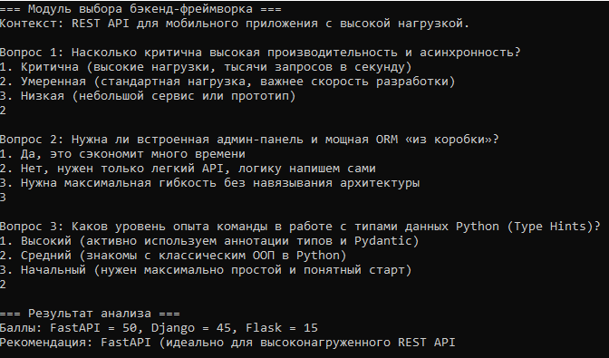
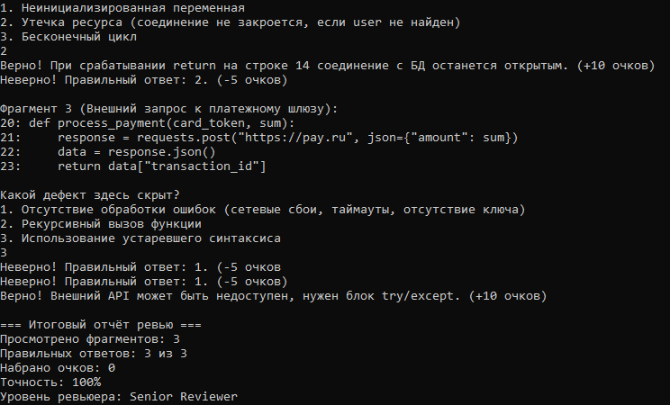
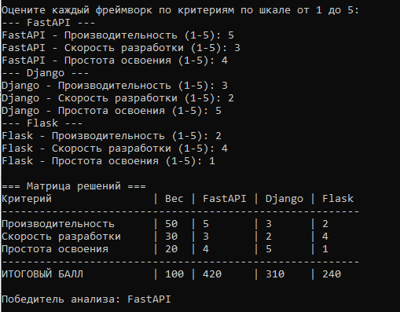
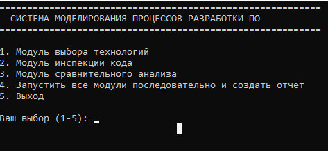
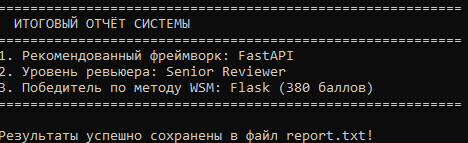

# Лабораторная работа №2
**Тема:** Моделирование процессов принятия решений в разработке ПО  
**Выполнил:** Мирончиков Александр Максимович 
**Группа:** 3525П1ИН1
**Вариант:** 6 
**Ссылка на репозиторий GitHub:** (https://github.com/Raateer101/lab2-Mironchikov)

---

## 1. Листинги модулей с комментариями

### 1.1. Модуль выбора технологий (`chapter1.bat`)
Модуль реализует интерактивный опрос о требованиях к проекту. С помощью команд `choice` и `set /a` система начисляет баллы каждому кандидату и определяет наиболее подходящий бэкенд-фреймворк, сохраняя результат в переменную `res_mod1`.

~~~bat
@echo off
chcp 65001 > nul
:: Инициализация счётчиков баллов для каждого кандидата
set score_fastapi=0
set score_django=0
set score_flask=0

echo === Модуль выбора бэкенд-фреймворка ===
echo Контекст: REST API для мобильного приложения с высокой нагрузкой.
echo.

:: Опрос пользователя с использованием команды choice и начислением весов
echo Вопрос 1: Насколько критична высокая производительность и асинхронность?
echo 1. Критична (высокие нагрузки, тысячи запросов в секунду)
echo 2. Умеренная (стандартная нагрузка, важнее скорость разработки)
echo 3. Низкая (небольшой сервис или прототип)
choice /c 123 /n
if errorlevel==3 set /a score_flask+=15
if errorlevel==2 set /a score_django+=15
if errorlevel==1 set /a score_fastapi+=20
echo.

echo Вопрос 2: Нужна ли встроенная админ-панель и мощная ORM «из коробки»?
echo 1. Да, это сэкономит много времени
echo 2. Нет, нужен только легкий API, логику напишем сами
echo 3. Нужна максимальная гибкость без навязывания архитектуры
choice /c 123 /n
if errorlevel==3 set /a score_flask+=15
if errorlevel==2 set /a score_fastapi+=15
if errorlevel==1 set /a score_django+=20
echo.

echo Вопрос 3: Каков уровень опыта команды в работе с типами данных Python (Type Hints)?
echo 1. Высокий (активно используем аннотации типов и Pydantic)
echo 2. Средний (знакомы с классическим ООП в Python)
echo 3. Начальный (нужен максимально простой и понятный старт)
choice /c 123 /n
if errorlevel==3 set /a score_flask+=15
if errorlevel==2 set /a score_django+=10
if errorlevel==1 set /a score_fastapi+=15
echo.

:: Сравнение итоговых баллов и формирование рекомендации
echo === Результат анализа ===
echo Баллы: FastAPI = %score_fastapi%, Django = %score_django%, Flask = %score_flask%

if %score_fastapi% geq %score_django% if %score_fastapi% geq %score_flask% (
    set "res_mod1=FastAPI"
    echo Рекомендация: FastAPI (идеально для высоконагруженного REST API)
    goto end_mod1
)
if %score_django% geq %score_fastapi% if %score_django% geq %score_flask% (
    set "res_mod1=Django"
    echo Рекомендация: Django (лучший выбор для быстрого старта с готовой базой)
    goto end_mod1
)
set "res_mod1=Flask"
echo Рекомендация: Flask (подходит для легких и гибких микросервисов)

:end_mod1
echo.
pause
~~~
### 1.2. Модуль формализации процесса ревьюирования (`chapter2.bat`)
Модуль симулирует проведение Code Review для фрагментов бэкенд-кода на Python. За правильное определение дефекта начисляются баллы (`+10`), за ошибку — снимаются (`-5`). В конце вычисляется процент точности и присваивается грейд ревьюера (`res_mod2`).

~~~bat
@echo off
chcp 65001 > nul
set correct=0
set points=0
set total=3

echo === Модуль инспекции кода (Backend API) ===
echo.

:: Фрагмент 1: проверка на магическое число и мёртвое присваивание
echo Фрагмент 1 (Обработка запроса в FastAPI):
echo 01: @app.post("/orders/")
echo 02: async def create_order(user_id: int, amount: float):
echo 03:     tax = amount * 0.20
echo 04:     total = amount + tax
echo 05:     return {"status": "ok"}
echo.
echo Какой дефект здесь скрыт?
echo 1. Магическое число (0.20) и мертвое присваивание (total не используется)
echo 2. Утечка памяти
echo 3. Синтаксическая ошибка в декораторе
choice /c 123 /n
if errorlevel==3 (
    echo Неверно! Правильный ответ: 1. (-5 очков)
    set /a points-=5
) else if errorlevel==2 (
    echo Неверно! Правильный ответ: 1. (-5 очков)
    set /a points-=5
) else (
    echo Верно! Ставку налога нужно вынести в константу, а переменная total никуда не передается. (+10 очков)
    set /a correct+=1
    set /a points+=10
)
echo.

:: Фрагмент 2: проверка на утечку ресурса при досрочном выходе из функции
echo Фрагмент 2 (Работа с БД в обработчике маршрута):
echo 10: def get_profile(db_url):
echo 11:     conn = connect_db(db_url)
echo 12:     user = conn.query("SELECT * FROM users LIMIT 1")
echo 13:     if not user:
echo 14:         return {"error": "Not found"}
echo 15:     conn.close()
echo 16:     return user
echo.
echo Какой дефект здесь скрыт?
echo 1. Неинициализированная переменная
echo 2. Утечка ресурса (соединение не закроется, если user не найден)
echo 3. Бесконечный цикл
choice /c 123 /n
if errorlevel==3 (
    echo Неверно! Правильный ответ: 2. (-5 очков)
    set /a points-=5
) else if errorlevel==2 (
    echo Верно! При срабатывании return на строке 14 соединение с БД останется открытым. (+10 очков)
    set /a correct+=1
    set /a points+=10
) else (
    echo Неверно! Правильный ответ: 2. (-5 очков)
    set /a points-=5
)
echo.

:: Фрагмент 3: проверка на отсутствие обработки исключений
echo Фрагмент 3 (Внешний запрос к платежному шлюзу):
echo 20: def process_payment(card_token, sum):
echo 21:     response = requests.post("https://pay.ru", json={"amount": sum})
echo 22:     data = response.json()
echo 23:     return data["transaction_id"]
echo.
echo Какой дефект здесь скрыт?
echo 1. Отсутствие обработки ошибок (сетевые сбои, таймауты, отсутствие ключа)
echo 2. Рекурсивный вызов функции
echo 3. Использование устаревшего синтаксиса
choice /c 123 /n
if errorlevel==3 (
    echo Неверно! Правильный ответ: 1. (-5 очков)
    set /a points-=5
) else if errorlevel==2 (
    echo Неверно! Правильный ответ: 1. (-5 очков)
    set /a points-=5
) else (
    echo Верно! Внешний API может быть недоступен, нужен блок try/except. (+10 очков)
    set /a correct+=1
    set /a points+=10
)
echo.

:: Расчёт метрик эффективности и определение уровня ревьюера
echo === Итоговый отчёт ревью ===
echo Просмотрено фрагментов: %total%
echo Правильных ответов: %correct% из %total%
echo Набрано очков: %points%
set /a percentage=correct*100/total
echo Точность: %percentage%%%

if %percentage% geq 80 (
    set "res_mod2=Senior Reviewer"
    echo Уровень ревьюера: Senior Reviewer
) else if %percentage% geq 50 (
    set "res_mod2=Middle Reviewer"
    echo Уровень ревьюера: Middle Reviewer
) else (
    set "res_mod2=Junior Reviewer"
    echo Уровень ревьюера: Junior Reviewer
)
echo.
pause
~~~
### 1.3. Модуль сравнительного анализа альтернатив (`chapter3.bat`)
Модуль реализует метод взвешенной суммы (WSM). Включает проверку корректности суммы весов (должна равняться 100), расчёт итоговых баллов по формуле \(S = \sum(W \times X)\) и построение сводной таблицы в консоли.

~~~bat
@echo off
chcp 65001 > nul
echo === Модуль сравнительного анализа (Метод WSM) ===
echo.

:: Ввод весов критериев с валидацией суммы (100%)
:weights
echo Назначьте веса критериям в процентах (сумма должна быть равна 100):
set /p w1="Вес 1 (Производительность и асинхронность): "
set /p w2="Вес 2 (Скорость разработки и готовый функционал): "
set /p w3="Вес 3 (Простота освоения и порог входа): "

set /a total_weight=w1+w2+w3
if %total_weight% neq 100 (
    echo [Ошибка] Сумма весов равна %total_weight%, а должна быть 100! Попробуйте снова.
    echo.
    goto weights
)

:: Оценка альтернатив по шкале от 1 до 5
echo.
echo Оцените каждый фреймворк по критериям по шкале от 1 до 5:
echo --- FastAPI ---
set /p fa_1="FastAPI - Производительность (1-5): "
set /p fa_2="FastAPI - Скорость разработки (1-5): "
set /p fa_3="FastAPI - Простота освоения (1-5): "

echo --- Django ---
set /p dj_1="Django - Производительность (1-5): "
set /p dj_2="Django - Скорость разработки (1-5): "
set /p dj_3="Django - Простота освоения (1-5): "

echo --- Flask ---
set /p fl_1="Flask - Производительность (1-5): "
set /p fl_2="Flask - Скорость разработки (1-5): "
set /p fl_3="Flask - Простота освоения (1-5): "

:: Вычисление взвешенных сумм
set /a score_fa=fa_1*w1 + fa_2*w2 + fa_3*w3
set /a score_dj=dj_1*w1 + dj_2*w2 + dj_3*w3
set /a score_fl=fl_1*w1 + fl_2*w2 + fl_3*w3

:: Вывод матрицы решений и объявление победителя
echo.
echo === Матрица решений ===
echo Критерий                ^| Вес ^| FastAPI ^| Django ^| Flask
echo ---------------------------------------------------------
echo Производительность      ^| %w1%  ^| %fa_1%       ^| %dj_1%      ^| %fl_1%
echo Скорость разработки     ^| %w2%  ^| %fa_2%       ^| %dj_2%      ^| %fl_2%
echo Простота освоения       ^| %w3%  ^| %fa_3%       ^| %dj_3%      ^| %fl_3%
echo ---------------------------------------------------------
echo ИТОГОВЫЙ БАЛЛ           ^| 100 ^| %score_fa%     ^| %score_dj%    ^| %score_fl%
echo.

if %score_fa% geq %score_dj% if %score_fa% geq %score_fl% (
    set "res_mod3=FastAPI (%score_fa% баллов)"
    echo Победитель анализа: FastAPI
    goto end_mod3
)
if %score_dj% geq %score_fa% if %score_dj% geq %score_fl% (
    set "res_mod3=Django (%score_dj% баллов)"
    echo Победитель анализа: Django
    goto end_mod3
)
set "res_mod3=Flask (%score_fl% баллов)"
echo Победитель анализа: Flask

:end_mod3
echo.
pause
~~~

### 1.4. Главный модуль интеграции (`lab_system.bat`)
Главный исполняемый файл организует пользовательское меню, вызывает отдельные модули через команду `call` в едином пространстве переменных окружения, агрегирует результаты и экспортирует их в файл `report.txt`.

~~~bat
@echo off
cd /d "%~dp0"
chcp 65001 > nul
set "res_mod1=Не пройдено"
set "res_mod2=Не пройдено"
set "res_mod3=Не пройдено"

:menu
cls
echo ==========================================================
echo   СИСТЕМА МОДЕЛИРОВАНИЯ ПРОЦЕССОВ РАЗРАБОТКИ ПО
echo ==========================================================
echo.
echo 1. Модуль выбора технологий
echo 2. Модуль инспекции кода
echo 3. Модуль сравнительного анализа
echo 4. Запустить все модули последовательно и создать отчёт
echo 5. Выход
echo.
set /p choice="Ваш выбор (1-5): "

if "%choice%"=="1" goto run1
if "%choice%"=="2" goto run2
if "%choice%"=="3" goto run3
if "%choice%"=="4" goto run4
if "%choice%"=="5" exit
goto menu

:run1
cls
call chapter1.bat
goto menu

:run2
cls
call chapter2.bat
goto menu

:run3
cls
call chapter3.bat
goto menu

:: Последовательный запуск всех модулей и генерация файла отчёта
:run4
cls
call chapter1.bat
cls
call chapter2.bat
cls
call chapter3.bat
cls
echo ==========================================================
echo   ИТОГОВЫЙ ОТЧЁТ СИСТЕМЫ
echo ==========================================================
echo 1. Рекомендованный фреймворк: %res_mod1%
echo 2. Уровень ревьюера: %res_mod2%
echo 3. Победитель по методу WSM: %res_mod3%
echo ==========================================================

> report.txt echo === ИТОГОВЫЙ ОТЧЁТ СИСТЕМЫ ПРИНЯТИЯ РЕШЕНИЙ ===
>> report.txt echo Дата формирования: %date% %time%
>> report.txt echo --------------------------------------------------
>> report.txt echo Модуль 1 (Рекомендация): %res_mod1%
>> report.txt echo Модуль 2 (Ревью кода): %res_mod2%
>> report.txt echo Модуль 3 (Метод WSM): %res_mod3%
>> report.txt echo --------------------------------------------------

echo.
echo Результаты успешно сохранены в файл report.txt!
pause
goto menu
~~~
---

## 2. Скриншоты работы системы

### 2.1. Работа модуля выбора технологий (`chapter1.bat`)

### 2.2. Работа модуля инспекции кода (`chapter2.bat`)

### 2.3. Работа модуля сравнительного анализа (`chapter3.bat`)

### 2.4. Главное меню интегрированной системы (`lab_system.bat`)

### 2.5. Прохождение всех модулей и итоговый отчёт

---

## 3. Описание работы интегрированной системы

* **Какие диалоги и вопросы задавались в каждом модуле:**
  * В **первом модуле** система уточняла требования к будущему REST API: критичность высокой производительности и асинхронности, потребность во встроенной админ-панели и ORM, а также опыт команды в работе с аннотациями типов (Type Hints).
  * Во **втором модуле** были предложены три фрагмента кода на Python, имитирующие работу с маршрутами API, подключением к базе данных и запросами к внешнему платёжному шлюзу. Требовалось классифицировать дефекты (магическое число, утечка ресурса, отсутствие обработки исключений).
  * В **третьем модуле** пользователь распределял 100% веса между тремя критериями («Производительность», «Скорость разработки», «Простота освоения») и оценивал каждый из трёх фреймворков по 5-балльной шкале.

* **Какие рекомендации были сформированы:**
  * По результатам анкетирования в Модуле 1 для высоконагруженного мобильного API был рекомендован фреймворк **FastAPI**.
  * В Модуле 2 при безошибочном обнаружении всех трёх дефектов присваивается квалификация **Senior Reviewer** (точность 100%, 30 баллов).
  * В Модуле 3 при высоком весе критерия производительности лидером по методу взвешенной суммы также стал **FastAPI**.

* **Как выглядел итоговый отчёт системы:**
  * После завершения третьего модуля экран консоли очистился и вывел сводную рамку с результатами всех трёх этапов, а в корневой директории проекта автоматически сформировался текстовый файл `report.txt` с датой, временем запуска и итоговыми выводами.

* **Впечатления от работы с системой:**
  * Разработка модульной архитектуры на языке командной оболочки Windows (Batch) позволила на практике понять принципы изоляции компонентов и их последующей интеграции через общие переменные среды. Формализация критериев выбора избавляет от субъективности при принятии архитектурных решений.

---

## 4. Инструкция по запуску для пользователя

1. Скачайте все файлы репозитория (`lab_system.bat`, `chapter1.bat`, `chapter2.bat`, `chapter3.bat`) в одну папку на компьютере под управлением ОС Windows.
2. Убедитесь, что все файлы сохранены в кодировке **UTF-8** (без BOM).
3. Запустите главный файл **`lab_system.bat`** двойным кликом левой кнопки мыши.
4. В открывшемся меню введите цифру нужного режима (`1`–`3` для запуска отдельного модуля или `4` для последовательного прохождения всей системы) и нажмите клавишу `Enter`.
5. После прохождения режима `4` ознакомьтесь со сформированным файлом **`report.txt`**, который появится в той же папке.
